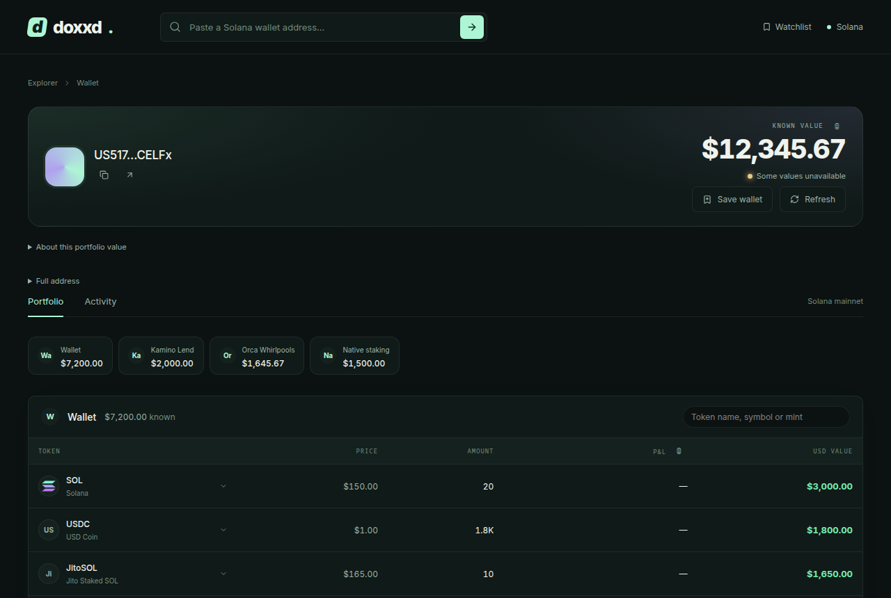

# Doxxd

Look up any public Solana wallet and see its holdings, staking, lending, liquidity and trading positions and activity, powered by the [DMND](https://dmnd.dev) API.

[](https://github.com/HankWyatt/doxxd/actions/workflows/ci.yml)
[](LICENSE)



*A synthetic portfolio built from the test fixtures. It queries no wallet.*

## Features

- **No sign-up.** Paste a public address. No wallet connection or account is required.
- **Portfolio.** The headline is DMND's authoritative known net value. Holdings page 20 at a time, are searchable by name, symbol or mint, and show indexed buy/sell totals and P&L estimates where DMND has trading history. Expandable protocol views cover native staking, liquid staking, Kamino, Solend, MarginFi, Orca, Raydium, Meteora DLMM, Meteora DAMM v2, Drift and Velocity.
- **Activity.** Observed executions, transfers, fees and net changes, with UTC date filters and opaque cursor pages kept in the URL.
- **Watchlist.** Save addresses and optional labels in your browser. The list makes no wallet data requests.
- **Server-only gateway.** DMND credentials never reach the browser. The browser calls same-origin `/api/wallet/...` routes, and a data error never substitutes synthetic values.

## Quick start

Use Node 22.13 or newer. From the repository root:

```sh
cd web
npm run install:ci
npm run dev -- --host 127.0.0.1 --port 4317
```

Visit `http://127.0.0.1:4317/` and enter a Solana address. There is no public demo or sample-data route; synthetic fixtures are used only by the automated tests.

Wallet routes are `/wallet/<address>` and `/wallet/<address>/activity`. They need a DMND API key (see below). Without one they show a connection state, never synthetic data.

## Configuration

Live data comes from the [DMND API](https://docs.dmnd.dev) through a server-side gateway. Get an API key at [dmnd.dev](https://dmnd.dev). Set these environment names when starting the server; the same names are documented in [`web/.env.example`](web/.env.example). Never expose credentials with a `NEXT_PUBLIC_` prefix, and keep local secrets out of Git.

| Name | Purpose |
| --- | --- |
| `DMND_API_BASE_URL` | DMND API root; default `https://api.dmnd.dev/api/v1`. HTTPS is required except for loopback in development. |
| `DMND_API_KEY` | Server-only credential. Missing or invalid configuration displays a connection state. |
| `DMND_ENABLED_PROTOCOLS` | Comma-separated **resource IDs** qualified by DMND for serving. Default empty. |
| `DMND_ALLOWED_WALLETS` | Optional server allowlist of wallet addresses; omit for public arbitrary-wallet use. |
| `DMND_REQUEST_BUDGET` | Optional per-runtime upstream request cap, integer 1-34. Omit for normal public operation. |

Protocol IDs: `stake`, `liquid-staking`, `kamino`, `solend`, `marginfi`, `orca`, `raydium-clmm`, `meteora`, `meteora-damm-v2`, `raydium-cpmm`, `raydium-amm-v4`, `raydium-farms`, `drift`, `velocity`. These are supported consumer views, not a claim that every upstream protocol is currently activated. Summary, overview, indexed trading positions and activity use fixed routes independently.

The gateway accepts only known resources and validated filters, rejects redirects and mismatched wallets or summary component sources, times out requests, and returns safe errors. Known summary components must identify the correct wallet, resource and protocol; future components retain canonical wallet-scoped provenance and the service's authoritative total. Protocol requests are lazy and limited to four at a time.

Token images load lazily from credential-free HTTPS URLs on DNS hostnames, with no page referrer. Native IPFS image URIs resolve through HTTPS, and IPFS images can retry the same CID and path through a bounded set of public gateways. Literal IPs, local hostnames and custom ports are refused; missing or failed images fall back to initials. Native SOL uses a local vector icon. Images are loaded by the browser, never through a server proxy.

Portfolio resources recheck queued or running scans and temporary request failures automatically, every five seconds after a response and respecting `Retry-After`. Checks stop when the data is ready, after twenty retries, or after two minutes; a hidden tab pauses them without extending that window. Loaded values stay visible if a refresh fails, and a status notice explains automatic checks, retained data and the manual **Check again** fallback. This applies to the overview, the summary and the first page of expanded protocol views; activity history and continuation pages keep manual refresh. Partial coverage, missing prices and disabled protocols do not start polling.

## Scripts

Run these from `web/`.

| Command | What it does |
| --- | --- |
| `npm run install:ci` | Clean install from the lockfile |
| `npm run dev` | Start the Vinext development server |
| `npm run build` | Build the Worker bundle |
| `npm start` | Preview the built Worker locally through Wrangler; it does not deploy |
| `npm test` | Unit and component tests (Vitest) |
| `npm run typecheck` | TypeScript check |
| `npm run test:e2e` | Browser tests (Playwright Chromium) against an isolated synthetic server |
| `npm run contracts:generate` | Regenerate API types and validation schemas from the pinned contract |
| `npm run lint` | ESLint; it currently reports existing issues and is not part of CI |

After `npm run build`, `DOXXD_E2E_BUILT=1 npm run test:e2e` runs the browser tests against the compiled Worker instead of the development server.

`web/scripts/` also holds staged live-verification tooling (`acceptance:dmnd`, `start:dmnd`, `verify:dmnd-runtime`). It is maintainer tooling and is not needed to run, build or contribute to the application.

## Project layout

| Location | Responsibility |
| --- | --- |
| `web/app/` | Public pages and fixed same-origin API routes |
| `web/components/wallet/`, `activity/` | Compact tables and expandable position and transaction detail |
| `web/lib/dmnd/` | Generated types, registry, validation, server gateway |
| `web/lib/portfolio/` | Protocol presentation adapters; no on-chain decoding |
| `web/lib/watchlist.ts`, `use-watchlist.ts`, `web/components/watchlist/` | Versioned browser-local saved addresses; no data acquisition |
| `web/lib/fixtures/` | Synthetic test data; there is no public fixture endpoint |
| `web/contracts/` | Pinned DMND OpenAPI contract and source revision |
| `web/tests/` | Synthetic fixtures and isolated Chromium flows |
| `web/scripts/` | Build, runtime and staged live-verification tooling |
| `scripts/` | Contract synchronization |

The application uses React, TypeScript and the Sites Vinext runtime.

## Data principles

The headline uses DMND's authoritative known net value. Doxxd does not sum protocol pages or calculate financial positions. Unknown values remain unknown; missing data does not establish an empty wallet. Receipt references are labeled as overlapping holdings. LP position NFTs in holdings are labeled as position receipts that overlap protocol positions; they are never priced or valued, and their creator-supplied token metadata is not a verification signal. Source clocks, coverage, debt, raw rewards and page-scoped subtotals retain their upstream meaning.

Expanded Marginfi details preserve raw shares, bank amounts, underlying quantities and independent price/bank/position clocks. Expanded spot/perp details preserve raw scaled balances and exact source base/quote amounts. A scaled balance is not a token quantity; base/quote amounts are not USD, equity or profit. Saved protocol snapshots retain their incomplete coverage and disabled-scan reason even when a price observation is newer.

Expanded native-stake rows preserve raw account lamports, staker/withdrawer, lockup fields and activation/deactivation epochs. Epochs and Unix seconds remain source values; delegated lamports do not imply effective or withdrawable stake. Stored rows remain visible with partial coverage when acquisition is disabled.

Holdings show 20 observations per page. **Search observed holdings** searches every loaded token name, symbol and mint, including unpriced assets beyond the visible page. Paging and search make no additional wallet requests. The observation count, known subtotal and coverage continue to describe the full loaded response. A search with no matches does not establish an empty wallet; blank token labels fall back to the mint.

Holdings show K/M/B token amounts; expanded rows keep exact quantities and raw atoms. The independent `positions` resource adds indexed buy/sell USD subtotals, trade counts, last-trade dates and explicitly labeled average-cost P&L estimates, joined by exact mint. Missing trading rows stay unknown, and native SOL never inherits wrapped SOL results. One page of 100 indexed tokens loads on its own; more pages need a click. These figures cover partial indexed history, not complete wallet profit: opening balances, transfers, fees and missing prices can change actual results.

Activity presents observed executions, transfers, fees and net changes without inferring DeFi actions from balance deltas. Expanded history coverage keeps token and native SOL capture starts, completeness, reason codes and source slots separate. An empty page does not establish an empty activity window; unavailable continuation is explained with a manual retry. UTC filters and opaque cursor pages remain in the URL. Neutral balance-change fallback has a separate cursor scope.

Expanded balance changes retain the exact source atoms, unit amount, decimals, observation kind, mint and transaction index. Compact amounts may be rounded for the table; the source amount remains available in the expansion. A native observation with no mint is identified as native SOL; an unknown token mint stays unknown.

Values are shown as reported by the upstream service; this is not financial advice.

## Contributing

Contributions are welcome. See [CONTRIBUTING.md](CONTRIBUTING.md) for setup, checks and the fixture rules, and the [Code of Conduct](CODE_OF_CONDUCT.md) for how we work together. Issues and pull requests are both appreciated.

## Security

Please report vulnerabilities privately; see [SECURITY.md](SECURITY.md). Never post API keys or other credentials in issues or pull requests.

## License

[MIT](LICENSE) (c) 2026 Hank Wyatt
